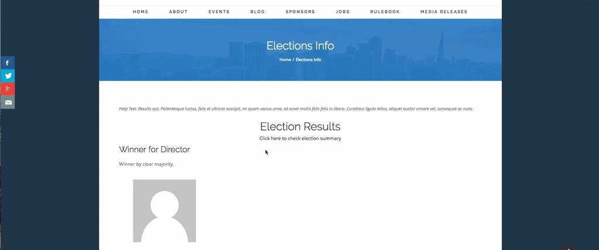

**Elections** (au.com.agileware.elections) turns your CiviCRM into a place where your organisation can hold real elections: nominate people, put them on a ballot, let your people vote, and publish the results, with no spreadsheets, no separate voting service and no export of your contacts to a third party. Your people are already in CiviCRM, so the election already knows who they are, which groups they belong to, and how to reach them.

It runs on **WordPress, Drupal and Joomla**, works on a phone, and is built to be used by everyone: keyboard and screen reader friendly, with light and dark appearance.

This page is a tour of what is possible. The **[documentation](https://github.com/agileware/au.com.agileware.elections/blob/master/docs/index.md)** is the full guide, with step by step instructions, diagrams and every option explained: it is worth reading before you set up your first election.

What you can run with it
------------------------

Anything where a group of people chooses someone, or says yes or no, on your CiviCRM site:

  * **Committee and board elections.** President, Secretary, Treasurer and three committee positions, each with its own candidates, on one ballot.
  * **Annual general meetings.** Positions and yes or no questions together: a motion to change the constitution, to raise fees, or to allow proxy votes, with a pass threshold and a quorum.
  * **Volunteer roles.** Let people nominate each other, or put themselves forward, and have the nominee accept before they appear on the ballot.
  * **Regional, state or chapter delegates.** Give each region its own election and use a CiviCRM group, or a smart group built from addresses, so only the right people see it and vote.
  * **Award and grants panels.** Turn online nominating off and let the organisers choose the candidates, or use one group to nominate and a different group to be eligible to stand.
  * **Show and event picks.** Use "most votes win" for people's choice, steward or stallholder selections where each voter ticks the people they like.
  * **Ballots at any time of year.** Run several elections at once, each with its own dates and its own groups, and keep the results as a record.

How an election works
---------------------

1. **Set it up.** Choose the dates, who can take part, how votes are counted and what voters see. A quick set-up fills in a sensible timetable for you.
1. **Add the positions and questions.** Any number, in any order, with the seats to be filled and, if you want, write-ins.
1. **Nominations.** People nominate others or themselves. A nominee who has enough nominations, and seconds if you require them, is invited by email to accept or decline, and can add a statement and a link.
1. **Voting.** Voters see the candidates, their statements and photos, rank or tick their choices, review the ballot and submit it. If you allow it, they can change their vote until voting closes.
1. **Results.** On the date you set, the winners are published, with how each was decided, and kept as a historical record.

Everything an election does follows the stage it is in, so organisers and voters always see where it is and what they can do next.

What you can configure
----------------------

Each election has its own settings, so a large annual election and a small workshop vote can sit side by side.

**Who takes part**

  * Separate groups for who may **vote**, who may **nominate** and who may **stand**, using CiviCRM Groups and Smart Groups. Anything you can express as a group becomes an electorate: country, region, interest, committee, or any other criterion.
  * No CiviCRM Membership is needed: being in one of the election's groups is what counts.
  * People who are not logged in can take part with a **personal link** sent by email, if you allow it.

**How people get on the ballot**

  * People nominate each other and themselves, or only the organisers choose the candidates.
  * The number of nominations, and seconds, a person needs before they can stand.
  * Nominees accept or decline, and candidates write a statement with an optional link to a longer statement or CV, which they can correct until voting ends.
  * Optional **write-ins**: voters add a person who is not listed, who is then invited to accept before voting closes.

**How votes are cast and counted**

  * **Ranked choice** (instant-runoff) or **most votes win**.
  * One or more seats for each position.
  * **Yes or no questions** (referendum questions) on the same ballot, with your own wording (For and Against, Approve and Reject), an optional Abstain, a pass threshold from a simple majority to two thirds or any percentage, a quorum, and the full resolution text.
  * Allow or disallow changing a vote.

**What people see**

  * Photos, written statements on the ballot or a click away, who nominated each candidate, and how names are shown, including nicknames.
  * A stage stepper and a single "what you can do now" button on each election.
  * A results page of your own, with a header, a footer, a logo, and an optional celebration when the winners appear.
  * Emails to nominees and people written in, using message templates you can edit in CiviCRM.

**Trust and privacy**

  * **Anonymise votes** when the results are generated, so nobody, including administrators, can tell who voted for whom.
  * One ballot for each person, enforced by the database. Results are generated once.
  * Results show winners, not counts, and a tie is shown as a tie.
  * A tamper-evident **audit log** with a fingerprint you can write down, and an integrity check on the election overview.
  * The settings that decide who votes and how votes count are locked once ballots exist.

**Running it**

  * Manage elections, positions, candidates, results and the audit log from searchable lists, with drag and drop ordering, duplicate, and activate or deactivate in one click.
  * An overview of each election: stage, timeline, turnout and integrity.
  * **Duplicate** last year's election to start this year's with the same positions.
  * Add it to a WordPress page with a short code, or use the pages CiviCRM provides on Drupal and Joomla.

Read the documentation
----------------------

The [documentation](https://github.com/agileware/au.com.agileware.elections/blob/master/docs/index.md) explains every screen and option in plain language, with workflow diagrams for each kind of election. Start with the first two chapters, then follow the third to set up your first election:

  * **Introduction**: [types of elections and options](https://github.com/agileware/au.com.agileware.elections/blob/master/docs/election_types.md) (positions and questions, ranked choice and most votes, who can take part and how people get on the ballot) and [workflow diagrams](https://github.com/agileware/au.com.agileware.elections/blob/master/docs/workflows.md) of the whole election lifecycle.
  * **Set up your site**: [initial set up](https://github.com/agileware/au.com.agileware.elections/blob/master/docs/setup.md) (scheduled jobs, permissions, personal links, the pages to create on WordPress, Drupal and Joomla), [roles and permissions](https://github.com/agileware/au.com.agileware.elections/blob/master/docs/roles_and_permissions.md) and the [site-wide settings](https://github.com/agileware/au.com.agileware.elections/blob/master/docs/admin_election_settings.md).
  * **Running an election**: [manage elections](https://github.com/agileware/au.com.agileware.elections/blob/master/docs/admin_manage_elections.md), [add an election](https://github.com/agileware/au.com.agileware.elections/blob/master/docs/admin_create_election.md), add [positions](https://github.com/agileware/au.com.agileware.elections/blob/master/docs/admin_add_position.md), [write-ins](https://github.com/agileware/au.com.agileware.elections/blob/master/docs/admin_write_ins.md) and [referendum questions](https://github.com/agileware/au.com.agileware.elections/blob/master/docs/admin_referendum.md), then [activate](https://github.com/agileware/au.com.agileware.elections/blob/master/docs/admin_activate_election.md) it, shape the [results page](https://github.com/agileware/au.com.agileware.elections/blob/master/docs/admin_results_page.md) and follow it through on the [election overview](https://github.com/agileware/au.com.agileware.elections/blob/master/docs/admin_election_overview.md).
  * **Taking part**: how people [nominate someone](https://github.com/agileware/au.com.agileware.elections/blob/master/docs/user_nominate.md), [accept a nomination](https://github.com/agileware/au.com.agileware.elections/blob/master/docs/user_accept_nomination.md), [vote](https://github.com/agileware/au.com.agileware.elections/blob/master/docs/user_vote.md) and [view the results](https://github.com/agileware/au.com.agileware.elections/blob/master/docs/user_view_results.md).
  * **Reference**: [emails and scheduled jobs](https://github.com/agileware/au.com.agileware.elections/blob/master/docs/reference_emails_and_jobs.md), and [security and audit](https://github.com/agileware/au.com.agileware.elections/blob/master/docs/reference_security_and_audit.md) (the guarantees, the audit log and the integrity check).

Elections is based on the voting features first built into [MemberDB](https://www.flamingspork.com/projects/memberdb/).

Viewing election results are shown below as an example.

  

Prerequisites
-------------

  * [CiviCRM](https://www.civicrm.org) 6.16 or greater, verified compatible up to 6.19.4 (version 2 of this extension; use version 1.x for older CiviCRM)  

Installation
-------------

1. Download this repository(whole extension folder) to your CiviCRM extension directory (available at 'System Settings / Resource URLs').
1. In CiviCRM, go to 'System Settings / Extensions' and enable **Elections**.
1. 'Elections' will now be available in the 'CiviCRM' menu. 
1. Click on the 'Elections' menu to display the Manage Elections page.

Getting Started
-------------

Read the [documentation](https://github.com/agileware/au.com.agileware.elections/blob/master/docs/index.md)  to get started setting up your first election. It covers the [types of elections and options](https://github.com/agileware/au.com.agileware.elections/blob/master/docs/election_types.md) (ranked choice, most votes, write-ins and referendum questions) and has [workflow diagrams](https://github.com/agileware/au.com.agileware.elections/blob/master/docs/workflows.md) of the stages, nominations, voting and results.

Settings
-------------

Once enabled, a global **Elections Settings** page is available at 'System Settings / Elections Settings' which controls the source of candidate photos and the default format of candidate names (for example including nicknames) shown throughout the extension. See [Elections Settings](https://github.com/agileware/au.com.agileware.elections/blob/master/docs/admin_election_settings.md) for details.

WordPress Short-codes
-------------

The following WordPress short-codes are available to seamlessly integrate elections with your WordPress website.

**Election listing short-code**

This is used on a page to list all active and completed elections.

```[civicrm component="elections" hijack="0" action="visible" viewpageid="XXXX"]```

When using the Election listing short-code, replace the **XXXX** (viewpageid) with the Post ID of the page where the Election information short-code embedded.

**Election information short-code**

This is used to display a single election which has been accessed from the election listing page.

```[civicrm component="electioninfo"  hijack="0"]```

When this page is accessed from the election listing page, the Election ID is passed to the Election information short-code using a URL parameter.

Sponsorship
------

Development of this CiviCRM extension and development of the PHP Unit Tests was kindly sponsored by [Linux Australia](https://linux.org.au).

 

Security
------

Please report security problems privately, not as public GitHub issues. See the [security policy](https://github.com/agileware/au.com.agileware.elections/blob/master/SECURITY.md) for how to report them and which versions are supported (2.x; 1.x is no longer supported).

About the Authors
------

This CiviCRM extension was developed by the team at [Agileware](https://agileware.com.au).

[Agileware](https://agileware.com.au) provide a range of CiviCRM services including:

  * CiviCRM migration
  * CiviCRM integration
  * CiviCRM extension development
  * CiviCRM support
  * CiviCRM hosting
  * CiviCRM remote training services

Support your Australian [CiviCRM](https://civicrm.org) developers, [contact Agileware](https://agileware.com.au/contact) today!

