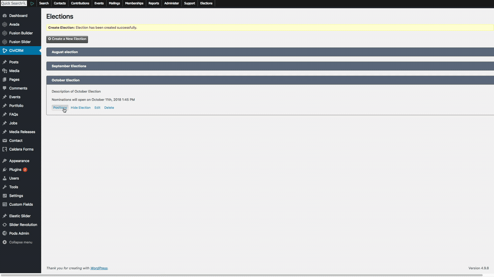
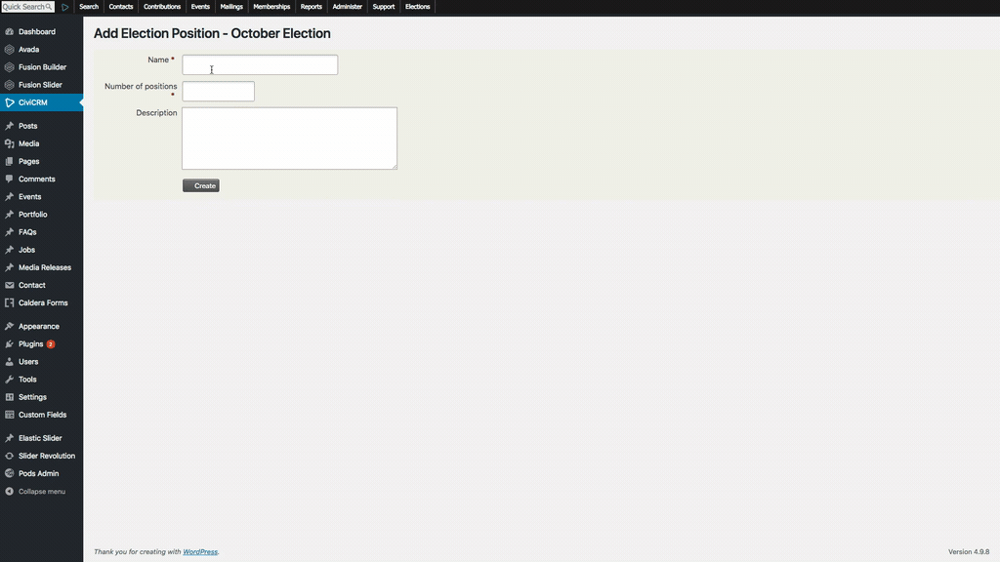
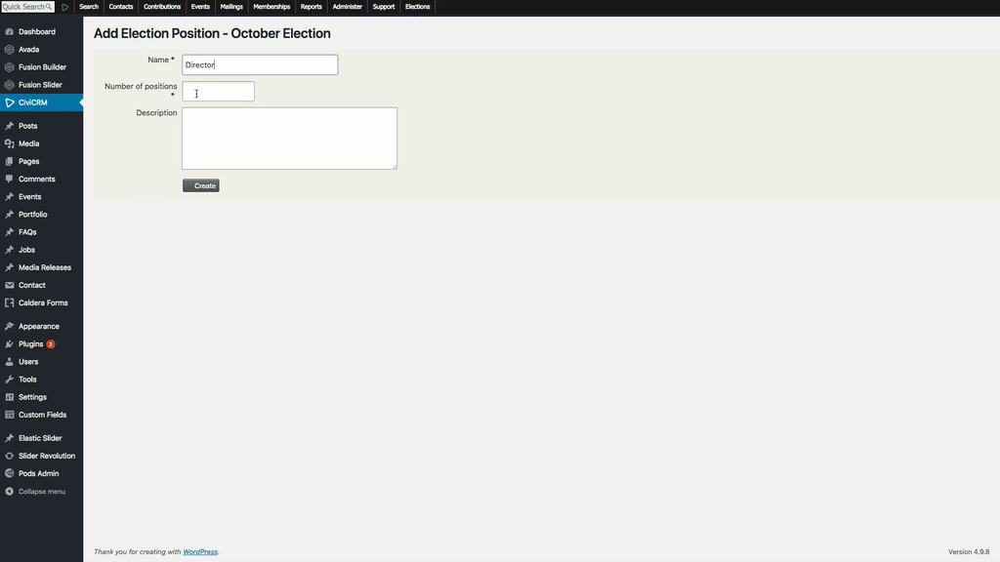
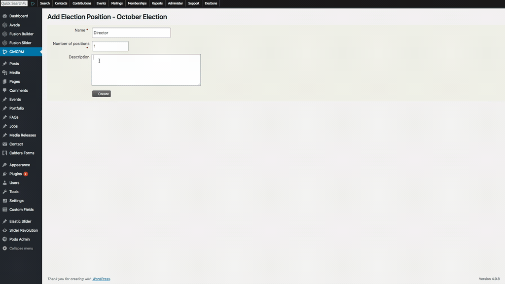

# How to add a position

To add a position, you need to have CiviCRM admin access and follow these steps:

1. Go to **Elections**
  
2. Select the number of positions on the election's row, or **Positions** on its overview, then **Add Position**. The page has a breadcrumb (**Manage Elections** > the election's name > **Positions** > **Add Position**).     
  
3. Enter information for the new position  
-  **Name**: The title of the position  
  
-  **Position type**: *Position* (people stand for it) or *Question* (a yes or no question, see [Referendum questions](admin_referendum.md))  
-  **Seats**: The total number seats available for the position  
  
-  **Order on the ballot**: The position's order relative to other positions, for example when listing positions for nomination, voting and results. Positions can also be reordered afterwards - see [How to reorder positions](admin_reorder_positions.md).
-  **Write-ins per seat**: How many people a voter may write in for each seat, from 0 to 10. 0 (the default) means write-ins are off for this position. See [Write-ins](admin_write_ins.md).
-  **Description**: A short description of the position  
  
4. Select **Submit** to add the position. The message "Position added." is shown. **Back** and **Back to Manage Elections** leave the form without saving.

A position can only be added before the election's **Nominations open** date, or while the election is inactive.
