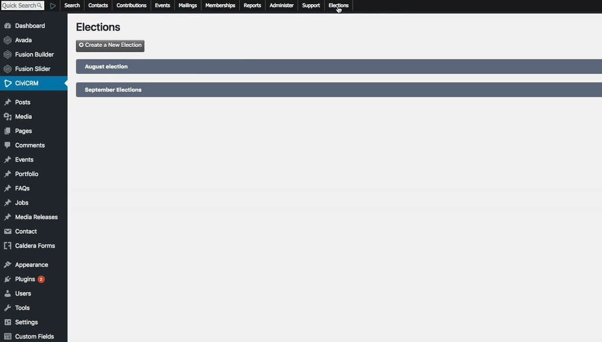
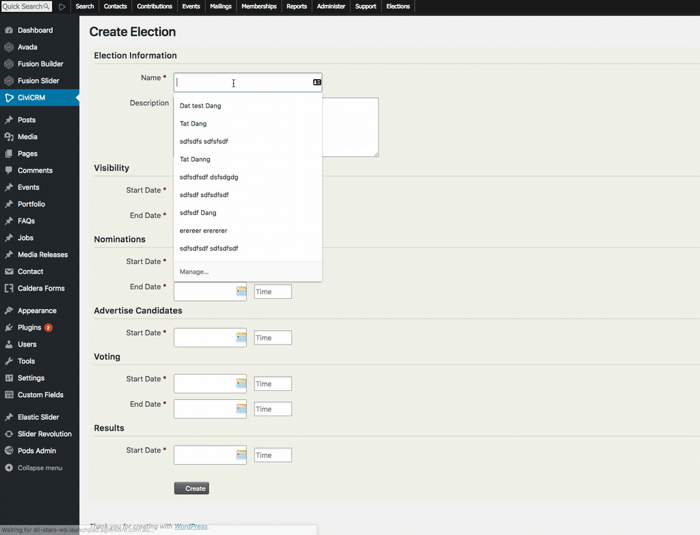
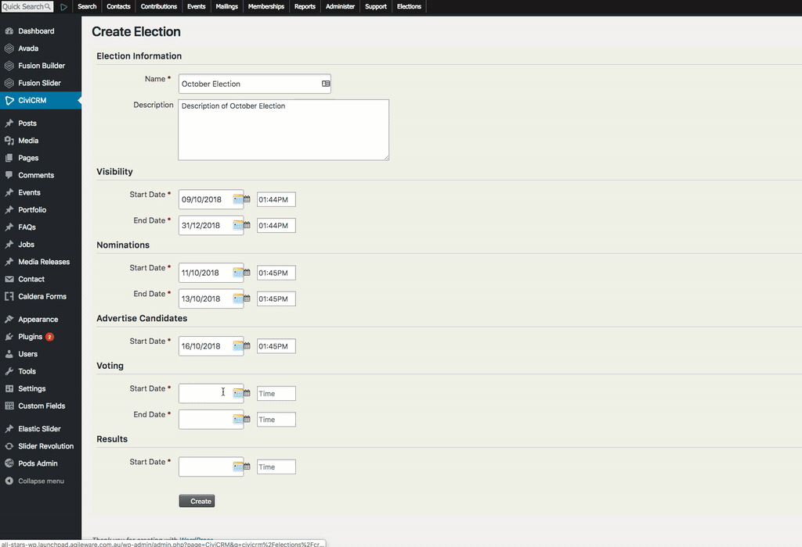

# How to create a new election

To create a new election, you should be a user who gains admin access for CiviCRM and follow these steps: 

1. Go to **Elections**  

2. Go to **Create Election**  

The form has four tabs: **Election** (name and description), **Dates**, **Participation** (settings) and **Display**. Move between them with the mouse or the left and right arrow keys. Required fields on a tab you have not opened are flagged when you click **Submit**, and a tab with a problem is marked with a !.

3. Enter information about the new election  
- **Name and Description**: enter the name and description of the new election. It helps users to know more about the election that they will participate.  

- **Visible Start Date**: set the date and time when user can start seeing it in the election section.  
- **Visible End Date**: set the date and time when the admin wants to hide the election from the election page.  
- **Nomination Start Date**: This date allows user to start nominating. This date should be after **Visible Start Date** and before **Visible End Date**  
- **Nomination End Date**: This date is to prevent user from nominating. This date should be after **Nomination Start Date** and before **Visible End Date**  
- **Advertise Start Date**: This date is to let user know that it waiting for nominees to accept their positions. This date should be after **Nomination End Date** and before **Visible End Date**  
- **Voting Start Date**: This date is to allow user to vote. This date should be after **Advertise Start Date** and before **Visible End Date**  
- **Voting End Date**: This date is to prevent user from voting. This date should be after **Voting Start Date** and before **Visible End Date**  
- **Results Start Date**: This date is to let users know when the results will be available. This date should be after **Voting End Date** and before **Visible End Date**  
  
The dates are checked as you change them: a date that is out of order is marked straight away with a message beside it, and the **Timeline** at the bottom of the **Dates** tab shows the stages in order with the one that is running now highlighted. Dates are also checked when you save.
4. On the **Participation** tab, configure the election's settings:
- **Voting Method**: how votes are cast and counted. **Ranked choice** (the default) has voters number the candidates in order of preference, and the count passes votes on until a candidate has a majority. **Most votes win** has voters tick up to as many candidates as there are seats for each position, and the candidates with the most ticks win. Candidates level on votes share a place; if they are level across the last seat the position is shown as a tie and every tied candidate is listed (the extension never picks one of them). The method cannot be changed once people have voted, and changes to it are written to the audit log.
- **Anonymise Votes**: If set to Yes, votes are anonymised once the election results are published, so it is no longer possible to see how an individual voted.
- **Allow Members to Change Vote**: If set to Yes, a member can vote again to change their earlier vote at any time before **Voting End Date**.
- **Allow non-logged in access**: If enabled, people can nominate, accept nominations and vote using a personalised link, without needing to log in. See [Participating without logging in](setup.md#participating-without-logging-in).
- **Number of Required Nominations**: The number of people who must nominate a person for a position before they become an eligible candidate. See [How to second a nomination](user_second_nomination.md).
- **Allowed by Groups**: The CiviCRM Groups and Smart Groups whose members are permitted to vote in this election. Unless you set the two groups below, the same people can also nominate, second and stand.
- **Nomination Groups** (optional): The groups whose members may nominate and second. Leave empty to use the *Allowed by Groups*. Someone in the *Allowed by Groups* but not in these can vote but is refused the nomination form.
- **Candidate Groups** (optional): The groups whose members may be nominated, accept a nomination, or be added as a candidate by an administrator. Leave empty to use the *Allowed by Groups*. A nominee must be a member of one of these groups at the moment they are nominated and again when they accept.

Group membership, including smart groups, is checked when each person acts. People who have already voted keep their vote, whatever happens to their membership later. The groups cannot be changed once people have voted. The same person may be in more than one group, and nominating yourself is allowed.
5. On the **Display** tab, choose the **Display options** for what voters see about candidates:
- **Show candidate photos**: untick to hide candidate photos everywhere in this election - the nominations list, candidate pages, the ballot and the results. Use this when you want voters to decide without photos.
- **Candidate statements**: candidates write a statement when they accept a nomination (see [How to accept a nomination](user_accept_nomination.md)). A statement is always shown on the candidate's own page. Choose whether it is also shown on the ballot, as an expandable *Read statement* or in full, and in the candidate list once voting has started.
- **Show who nominated each candidate**: untick to hide the nominators and seconders on the candidate page, for example when nominations are handled outside the website.
- **Candidate name format**: how candidate names are written. Use **First "Nickname" Last** to show, for example, Edward "Butch" Smith. Nicknames come from the contact's *Nickname* field. The default follows the site-wide setting, see [Elections Settings](admin_election_settings.md).
6. Click **Create** to create a new election.

The election is created inactive. At least one [Position](admin_add_position.md) must be added, and the election must be [activated](admin_activate_election.md), before it is visible to end users.