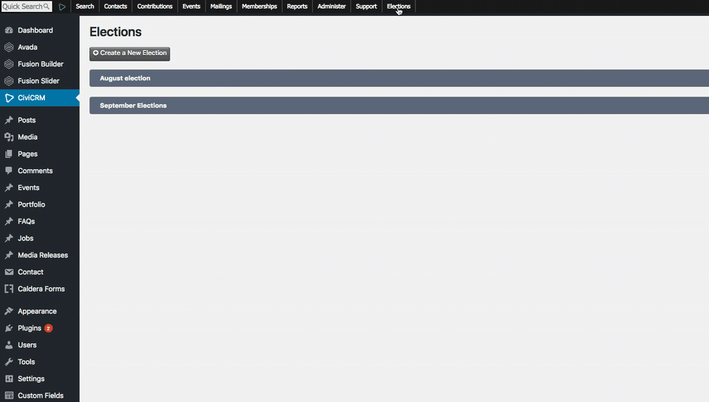
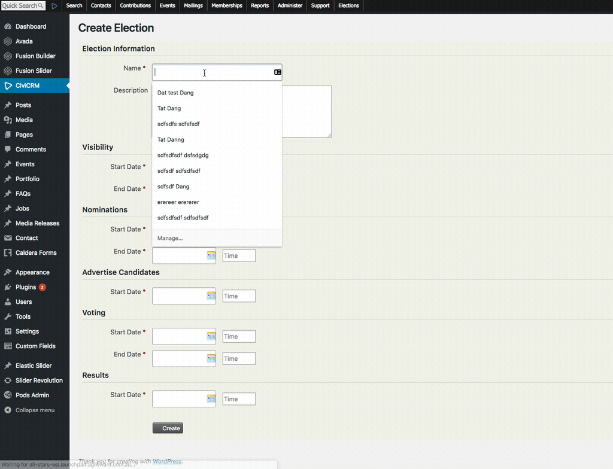
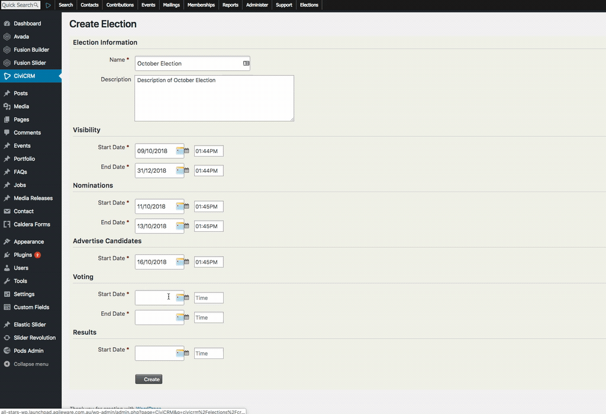

# How to add a new election

To add a new election, you should be a user who gains admin access for CiviCRM and follow these steps: 

1. Go to **Elections** (this opens **Manage Elections**)  

2. Select **Add Election**  

The page has a breadcrumb above the heading (**Manage Elections** > **Add Election**). The form has six tabs: **Details** (name and description), **Dates**, **Participation**, **Display**, **Emails** and **Privacy**. Move between them with the mouse or the left and right arrow keys. Required fields on a tab you have not opened are flagged when you select **Submit**, and a tab with a problem is marked with a !. The buttons at the bottom of the form are **Submit**, **Back** and **Back to Manage Elections**. **Back** and **Back to Manage Elections** leave the form without saving.

3. Enter information about the new election  
- **Name** and **Description** (on the **Details** tab): enter the name and description of the new election. It helps users to know more about the election that they will participate.  

- **Quick set-up** (top of the **Dates** tab): fills in all the dates for you. Choose an **Election cycle** (1 week of nominations and 1 week of voting; 2 and 2; 2 and 3; or 2 and 4), enter **Nominations start on**, set the times each phase starts (**Each phase starts at**, default 09:00) and ends (**Each phase ends at**, default 17:00), choose when **Results are published** (5 minutes after voting closes, or the morning after voting closes) and for how many weeks the election stays visible (**Election stays visible for (weeks after the results)**), then select **Fill in the dates**. The dates are worked out like this:
    - **Visible from** is the same moment nominations open.
    - Nominations run for whole weeks and close at the end time on the last day (Monday to Sunday when they open on a Monday).
    - Candidates are advertised from 5 minutes after nominations close.
    - Voting opens at the start time on the day after candidates are advertised, and runs for whole weeks, closing at the end time on the last day.
    - Results are published 5 minutes after voting closes, or at the start time the next morning.
    - **Visible until** is the chosen number of weeks (default 12) after the results are published.

  Every date it fills in passes the same checks as the form, and you can still change any of them. If dates were already entered you are asked before they are replaced. The times are clock times in the site's time zone, so a Daylight Saving change does not move them.
- The dates, below the quick set-up under the headings **Visibility**, **Nominations**, **Candidates**, **Voting** and **Results**. The tab says "Times are shown in" followed by the site's time zone, and the dates are entered and shown in the date format set in CiviCRM:
    - **Visible from**: the date and time when people can start seeing the election. Until then it is hidden from the election pages.
    - **Visible until**: the date and time after which the election is hidden from people.
    - **Nominations open**: from this date people can nominate each other. This date should not be before **Visible from** (it can be the same moment) and should be before **Visible until**.
    - **Nominations close**: people can nominate until this date. This date should be after **Nominations open** and before **Visible until**.
    - **Candidates advertised from**: from this date people can see the candidates, before voting opens, while nominees accept or decline. This date should be after **Nominations close** and before **Visible until**.
    - **Voting opens**: voters can vote from this date. This date should be after **Candidates advertised from** and before **Visible until**.
    - **Voting closes**: voters can vote until this date. This date should be after **Voting opens** and before **Visible until**.
    - **Results published on**: from this date people can see the results. This date should be after **Voting closes** and before **Visible until**.

  
The dates are checked as you change them: a date that is out of order is marked straight away with a message beside it (for example "Voting closes must be after Voting opens."), and the **Timeline** at the bottom of the **Dates** tab shows the stages in order with the one that is running now highlighted. Dates are also checked when you select **Submit**.
4. On the **Participation** tab, configure who takes part and how:
- **Voting groups**: The CiviCRM Groups and Smart Groups with people who are permitted to vote in this election. Unless you set the two groups below, the same people can also nominate, second and stand.
- **Nominating groups** (optional): The groups with people who may nominate and second. Leave empty to use the *Voting groups*. Someone in the *Voting groups* but not in these can vote but is refused the nomination form.
- **Candidate groups** (optional): The groups with people who may be nominated, accept a nomination, or be added as a candidate by an administrator. Leave empty to use the *Voting groups*. A nominee must be in one of these groups at the moment they are nominated and again when they accept.
- **Voting method**: how votes are cast and counted. **Ranked choice** (the default) has voters number the candidates in order of preference, and the count passes votes on until a candidate has a majority. **Most votes win** has voters tick up to as many candidates as there are seats for each position, and the candidates with the most ticks win. Candidates level on votes share a place; if they are level across the last seat the position is shown as a tie and every tied candidate is listed (the extension never picks one of them). The method cannot be changed once people have voted, and changes to it are written to the audit log.
- **Required nominations**: The number of people who must nominate a person for a position before they become an eligible candidate. See [How to second a nomination](user_second_nomination.md).
- **Allow people to nominate online**: On by default. Turn it off when the organisers choose the candidates themselves (for example the board decides): there is then no nomination form on the website, and you add candidates on the **Candidates** screen (see [Candidates](admin_candidates.md)). A candidate you add without ticking **Mark as accepted** is emailed (if emails are on) and asked to accept or decline, and the rest of the election works as usual.
- **Allow people to change their vote**: If ticked, a person can vote again to change their earlier vote at any time before **Voting closes**.
- **Allow people to take part without logging in**: If ticked, people can nominate, accept nominations and vote using a personal link, without needing to log in. See [Participating without logging in](setup.md#participating-without-logging-in).

Being in a group, including a smart group, is checked when each person acts. People who have already voted keep their vote, even if they leave the groups later. The groups cannot be changed once people have voted. The same person may be in more than one group, and nominating yourself is allowed.

If you cannot see any groups, the tab shows "You cannot see any groups." Your CiviCRM role needs the permission **View All Contacts** (or an ACL that allows the groups to be viewed) - see [Roles and permissions](roles_and_permissions.md).
5. On the **Display** tab, choose what voters see about candidates:
- **Show candidate photos**: untick to hide candidate photos everywhere in this election - the nominations list, candidate pages, the ballot and the results. Use this when you want voters to decide without photos.
- **Show candidate statements**: candidates write a statement when they accept a nomination (see [How to accept a nomination](user_accept_nomination.md)). A statement is always shown on the candidate's own page. Choose whether it is also shown on the ballot: **Not shown**, **Read statement** (expandable) or **In full**, and in the candidate list once voting has started.
- **Show who nominated each candidate**: untick to hide the nominators and seconders on the candidate page, for example when nominations are handled outside the website.
- **Candidate name format**: how candidate names are written. Use **First "Nickname" Last** to show, for example, Robert "Rob" Irwin. Nicknames come from the contact's *Nickname* field. The default (**Use the site setting**) follows the site-wide setting, see [Elections Settings](admin_election_settings.md).

   Under the heading **Results page** on the same tab, make the results page your own: **Header text**, **Footer text**, **Logo** with its **Logo description**, and **Show a celebration on the results page** with the **Celebration effect** and **Celebration lasts (days)** (5 by default). These can also be changed after the election has started. See [How to change the look of the results page](admin_results_page.md).
6. On the **Emails** tab:
- **Email people about their nominations**: When ticked, a nominee is emailed as soon as they have enough nominations to stand, asking them to accept or decline before voting opens. The email has an **Accept Nomination** link to the accept page (with a personal link when **Allow people to take part without logging in** is ticked, otherwise the nominee logs in first). The wording comes from the message template chosen in **Nomination email template** (default **Election - Invite nominee**); the link under the list, **Edit message templates (opens in a new tab)**, opens Message Templates, where you can edit it or add your own. See [Emails and scheduled jobs](reference_emails_and_jobs.md). Nobody who is marked *Do not email*, has no email address or is on hold is emailed. New elections start with this on; elections from before 2.0 keep it off. For bulk emails (for example reminding all voters that voting is open) use CiviMail or a scheduled reminder with the Election tokens.
7. On the **Privacy** tab:
- **Anonymise votes**: If ticked (the default for a new election), votes are anonymised once the election results are generated, so it is no longer possible to see how an individual voted.
8. Select **Submit** to add the new election. The message "Election added." is shown and you return to **Manage Elections**.

The election is added inactive. At least one [Position](admin_add_position.md) must be added, and the election must be [activated](admin_activate_election.md), before it is visible to end users.
