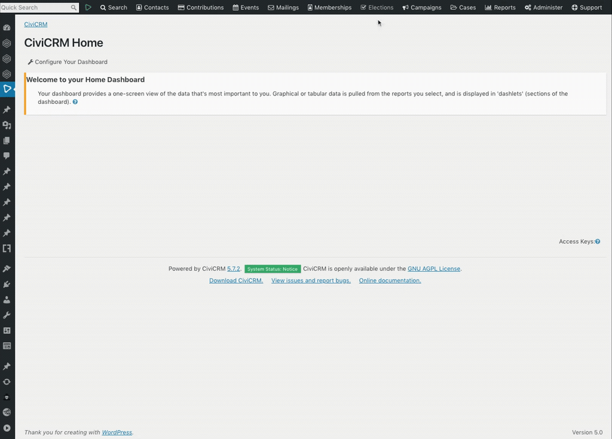
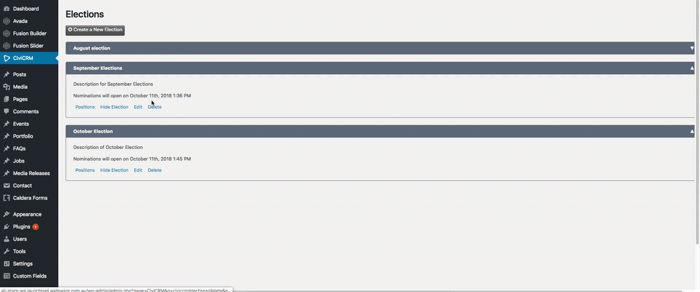

# How to delete an election

An election can only be deleted before its **Nominations open** date has passed while it is [active](admin_activate_election.md). Once nominations for an active election have started, it can no longer be deleted: the **Delete** dialog says "This election is active and its nominations have started, so it cannot be deleted. Deactivate the election first." and has only a **Cancel** button.

To delete an election, you should be a user who gains admin access for CiviCRM and follow these steps:

1. Go to **Elections**  
  
2. Select **Delete** on the election's row. A **Delete Election** dialog says that the election can no longer be seen or used, and that it cannot be restored from the screen.  
  
3. Select **Delete** to confirm, or **Cancel**. The message "Election deleted." is shown.
