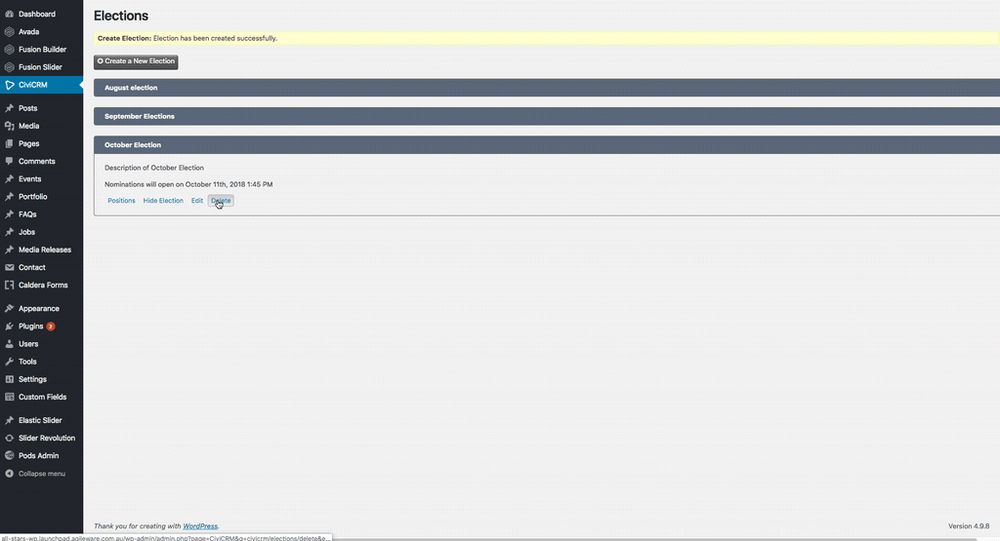
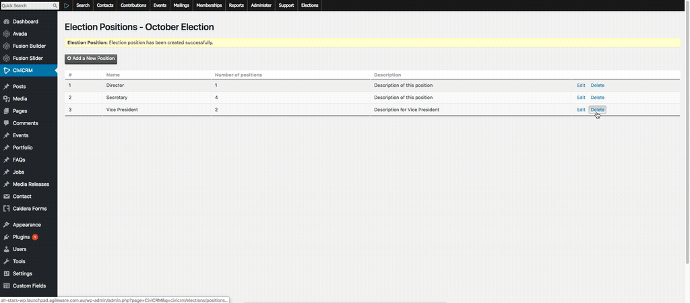

# How to delete a position

A position can only be deleted before the election's **Nominations open** date, or while the election is inactive.

To delete a position, you should be a user who gains admin access for CiviCRM and follow these steps:

1. Go to **Elections**  
  
2. Go to **Positions**  
  
3. Choose the election that has the position you want to delete  
4. Select **Delete** on the position's row. A **Delete Position** dialog says that the position and the nominations made for it will be deleted and cannot be recovered. Select **Delete** to confirm, or **Cancel**. The message "Position deleted." is shown.  

