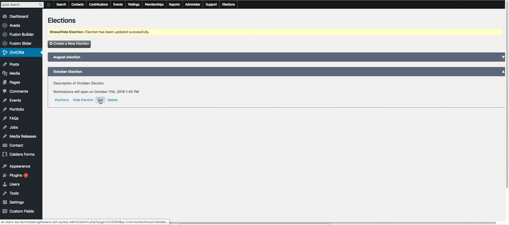

# How to edit an election

An election can only be edited before its **Nominations open** date has passed while it is [active](admin_activate_election.md). Once nominations for an active election have started, its details can no longer be edited: **Edit Election** on its overview is shown disabled with the reason, and the Edit Election page says "This election is active and its nominations have started, so it cannot be edited. Deactivate the election to edit it." with a **Back to Manage Elections** button. Editing an election does not change whether it is active.

To edit an election, you should be a user who gains admin access for CiviCRM and follow these steps:

1. Go to **Elections**  
  
2. Select **Edit** on the election's row, or **Edit Election** on its [overview](admin_election_overview.md)  
  
3. Edit information of an existing election. The page has a breadcrumb above the heading (**Manage Elections** > the election's name > **Edit Election**) and the same six tabs as [adding an election](admin_create_election.md): **Details**, **Dates**, **Participation**, **Display**, **Emails** and **Privacy**.
- **Name** and **Description** (**Details** tab): to edit the name and description of the election.  
- **Visible from** (**Dates** tab): to edit the date and time when people can start seeing the election.  
- **Visible until**: to edit the date and time when the admin wants to hide the election from the election page.  
- **Nominations open**: to edit the date nominations start. This date should not be before **Visible from** (it can be the same moment) and should be before **Visible until**  
- **Nominations close**: to edit the date nominations end. This date should be after **Nominations open** and before **Visible until**  
- **Candidates advertised from**: to edit the date candidates are shown. This date should be after **Nominations close** and before **Visible until**  
- **Voting opens**: to edit the date voting starts. This date should be after **Candidates advertised from** and before **Visible until**  
- **Voting closes**: to edit the date voting ends. This date should be after **Voting opens** and before **Visible until**  
- **Results published on**: to edit the date the results are shown. This date should be after **Voting closes** and before **Visible until**
- **Voting groups**, **Nominating groups** and **Candidate groups** (**Participation** tab): to change who may vote, who may nominate and second, and who may stand. Empty nominating or candidate groups mean the *Voting groups* (see [Add an election](admin_create_election.md)). None of the group settings can change once people have voted.
- **Voting method**: ranked choice or most votes win (it cannot be changed once people have voted).
- **Required nominations**: to edit the number of nominations a person needs to become an eligible candidate. See [How to second a nomination](user_second_nomination.md).
- **Allow people to nominate online** and **Allow people to change their vote**: to edit whether there is a nomination form, and whether people can vote again to change their vote before **Voting closes**.
- **Allow people to take part without logging in**: to edit whether people can participate using a personal link without logging in. See [Participating without logging in](setup.md#participating-without-logging-in).
- **Display** tab: what voters see about candidates, and the results page.
- **Emails** tab: **Email people about their nominations** and the **Nomination email template**.
- **Anonymise votes** (**Privacy** tab): to edit whether votes are anonymised once results are generated.
4. Select **Submit** to save the election. The message "Election saved." is shown and you return to the page you started from (the election's overview, or Manage Elections). **Back** and **Back to Manage Elections** leave the form without saving.
