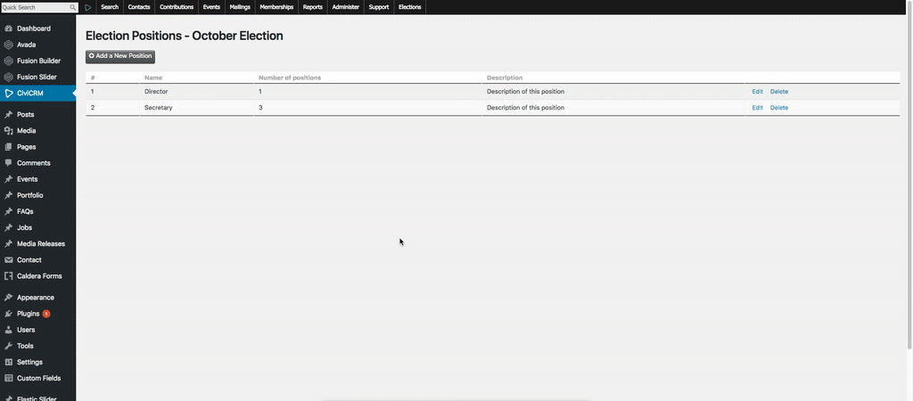
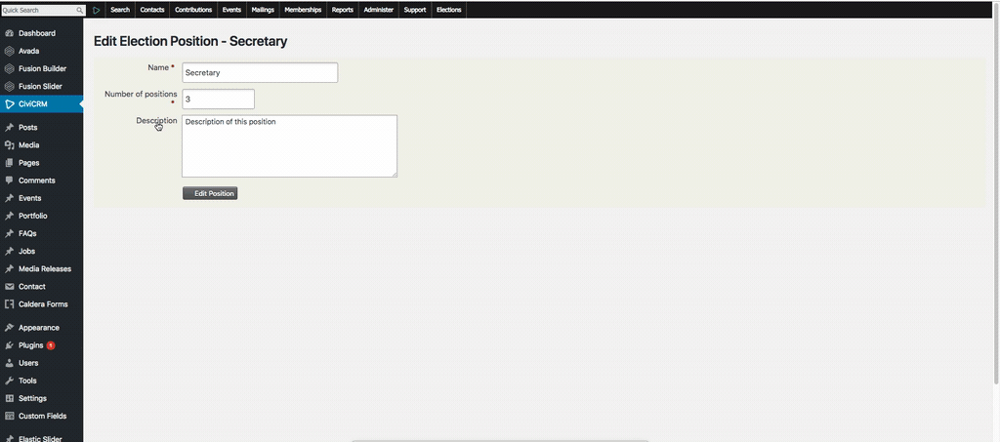

# How to edit a position

To edit a position, you need to have CiviCRM admin access and follow these steps:

1. Go to **Elections**  
  
2. Go to **Positions** for the election, then select **Edit** on the position's row. The page has a breadcrumb (**Manage Elections** > the election's name > **Positions** > **Edit Position**).  
  
3. Enter new information for an existing position  
-  **Name**: To set the title of the position  
-  **Seats**: To setup the number of people for a position  
-  **Order on the ballot**: To set the position's order relative to other positions. Positions can also be reordered by dragging and dropping - see [How to reorder positions](admin_reorder_positions.md).
-  **Write-ins per seat**: To allow voters to write people in (0 to 10 for each seat, 0 is off). See [Write-ins](admin_write_ins.md).
-  **Description**: To describe the position  
4. Select **Submit** to save the position. The message "Position saved." is shown. **Back** and **Back to Manage Elections** leave the form without saving.  
  

A position can only be edited before the election's **Nominations open** date, or while the election is inactive.
