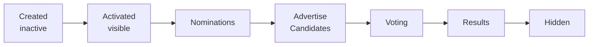

# Elections documentation

Elections (au.com.agileware.elections) is a CiviCRM extension which provides on-line elections to CiviCRM: nominations, ranked choice or most-votes ballots, write-ins, yes or no questions, and published results, on WordPress, Drupal and Joomla.

New to the extension? Read chapters 1 and 2, then follow chapter 3 to set up your first election.

## Words used in this guide

- **People**: everyone who takes part in an election. No CiviCRM Membership is needed; what matters is being in one of the election's groups.
- **Voters**, **nominees** and **candidates**: people at different stages of an election. A nominee becomes a candidate when they have enough nominations and accept.
- **Organisers**: the staff who set up and run elections.

## Contents

### 1. Introduction
- [Types of elections and options](election_types.md): positions and referendum questions, ranked choice and most votes, how people get on the ballot, who can take part, and how to choose.
- [Workflows](workflows.md): diagrams of the election lifecycle, nominations, write-ins, voting, results and referendum questions.

### 2. Set up your site
- [Initial set up](setup.md): scheduled jobs, permissions, personal links for people who do not log in, and the pages to create on WordPress, Drupal and Joomla.
- [Roles and permissions](roles_and_permissions.md): what an organiser, a person taking part and a site administrator each need.
- [Elections settings](admin_election_settings.md): site-wide photo source and name format.

### 3. Running an election (administrators)
1. [Manage elections](admin_manage_elections.md): the list of elections and what you can do with each.
2. [Create an election](admin_create_election.md): dates and settings, including the voting method, groups, emails and display options.
3. Add the positions and questions: [add a position](admin_add_position.md), [edit a position](admin_edit_position.md), [reorder positions](admin_reorder_positions.md), [delete a position](admin_delete_position.md).
   - [Write-ins](admin_write_ins.md): let voters add a person to the ballot.
   - [Referendum questions](admin_referendum.md): yes or no questions with a threshold and quorum.
4. [Activate the election](admin_activate_election.md) so people can see it.
5. Make the [results page](admin_results_page.md) your own: a logo, header and footer text and a celebration.
6. Follow it through with the [election overview](admin_election_overview.md) (stage, timeline, turnout, results and integrity) and manage the [candidates](admin_candidates.md).
7. [Edit](admin_edit_election.md), [duplicate](admin_duplicate_election.md) or [delete](admin_delete_election.md) an election.

### 4. Taking part (voters and candidates)
Follow the stages in order:
1. [Nominate someone](user_nominate.md) and [second a nomination](user_second_nomination.md).
2. [Accept a nomination](user_accept_nomination.md) (including when you are written in) or [withdraw it](user_withdraw_nomination.md).
3. [Vote](user_vote.md): ranked choice, most votes, write-ins and questions.
4. [View the results](user_view_results.md).

### 5. Reference
- [Emails and scheduled jobs](reference_emails_and_jobs.md): the message templates and the three jobs.
- [Security and audit](reference_security_and_audit.md): the guarantees, the audit log and the integrity check.

## An election at a glance

An election moves through fixed stages, each opened by a date: Nominations, Advertise Candidates, Voting, Results. Each stage is described, with diagrams for every kind of election, in [Workflows](workflows.md).

An election which is not activated, or which has no positions, is never shown to end users, whatever its dates. The election's dates and settings are explained in [Create an election](admin_create_election.md).
