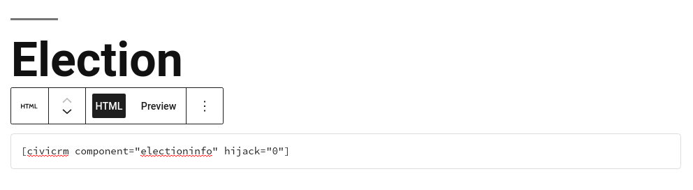
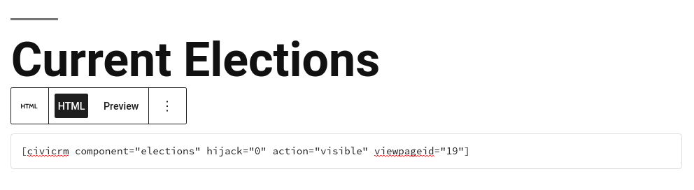
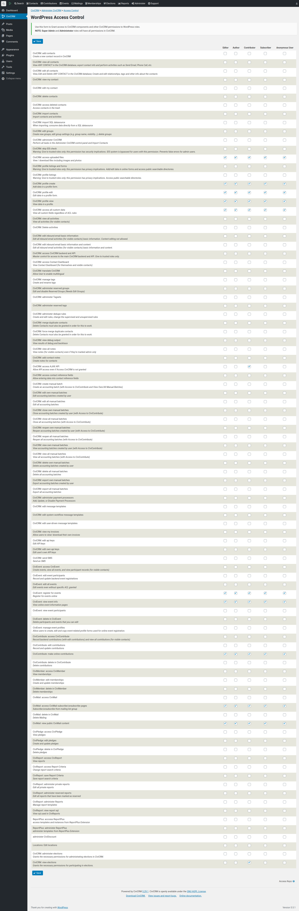

# Initial Set Up

This page documents the initial steps that need to be performed to configure your website and CiviCRM to host elections.

## Scheduled Jobs

The extension creates three CiviCRM Scheduled Jobs on installation, all **Enabled** by default:

- **Elections Results Job** (Always): calculates the [election results](user_view_results.md) shown on the results page. If it is not enabled or executed, no election results will be calculated.
- **Elections Write-in Reminders** (Hourly): reminds people written in who have not answered, in the last day before voting closes.
- **Elections Write-in Closed Notices** (Always): tells people written in who never answered that voting has closed and the opportunity to accept has passed.

CiviCRM's cron must be running for them to execute. See [Emails and scheduled jobs](reference_emails_and_jobs.md).

## CiviCRM Permissions

This extension adds two CiviCRM permissions:

- **administer Elections**: Required by staff to create, edit, delete and activate elections and positions from the CiviCRM 'Elections' administration screens. Staff also need the core **administer CiviCRM** permission to see the 'Elections' and 'Elections Settings' items in the CiviCRM menu.
- **view Elections**: Required by end users to participate in elections, for example to view, nominate, accept nominations or vote. See below for the additional permissions required on WordPress/CiviCRM sites.

## Participating without logging in

By default, a user must be logged in to nominate, accept a nomination or vote. Each election has an **Allow non-logged in access** setting which, when enabled, allows a person to perform these actions using a personalised link containing their CiviCRM contact ID and checksum (`cid` and `cs` URL parameters), without needing to log in. This is useful for inviting people to participate who do not have a website user account.

A personalised link can be generated for a contact using CiviCRM's standard checksum tokens (for example `{contact.checksum}`) in a mailing or PDF letter, combined with the contact's ID, appended to the election page URL, for example: `https://example.org/elections/view?eid=1&cid={contact.contact_id}&cs={contact.checksum}`.

This extension also provides `election_name`, `election_position`, `nominator_name` and `nominee_name` tokens for the **Nomination** activity, and an `election_name` token for the **Vote** activity, for use when emailing people about their nominations or votes.

## For WordPress/CiviCRM Sites

### Before you start: permalinks and the CiviCRM base page (required)

Election pages only display correctly on WordPress when both of these are in place:

1. **Pretty permalinks.** In WordPress go to _Settings > Permalinks_ and choose anything other than _Plain_ (for example _Post name_). Without them CiviCRM pages are reached with the `/?page=CiviCRM&q=civicrm/elections/view` form of address, which WordPress shows inside your blog or home page template (with a "Blog" heading, or an author and comment area) instead of as a normal page.
2. **The CiviCRM base page.** CiviCRM creates a page (usually called _CiviCRM_, slug `civicrm`) and uses it to show all CiviCRM screens at addresses such as `https://example.org/civicrm/elections/view/?eid=1`. Check that it exists and is published, and that CiviCRM's _WordPress Base Page_ setting (`wpBasePage`) names it. The links the extension builds, including the personal links for people who do not log in, rely on it.

With both in place the election screens use your theme's normal page layout and button styles; no theme customisation is needed (tested with Twenty Twenty-Five).

### Create Pages for the Election Listing and Individual Election
1. Create a Page to display the election information. This page can be called anything, but typically _Election_.
2. Insert the Election information short-code as a **HTML element** on the page: ```[civicrm component="electioninfo" hijack="0"]```
3. Publish the page and take note of the Page ID.

4. Create a Page to contain the listing of current elections. This page can be called anything, but typically _Current Elections_.
5. Insert the Election listing short-code as a **HTML element** on the page. Use the Page ID from the election information page as the _viewpageid_ parameter: ```[civicrm component="elections" hijack="0" action="visible" viewpageid="19"]``` - shown where the election information Page ID = 19.
6. Publish the page and take note of the Page ID.
 

### Set up CiviCRM Permissions

1. In CiviCRM, on the WordPress Access Control page,  _/wp-admin/admin.php?page=CiviCRM&q=civicrm%2Fadmin%2Faccess%2Fwp-permissions&reset=1_
2. Enable these two additional permissions for the **User Roles** that need to _participate in the election_
-  **CiviCRM: access AJAX API**
-  **CiviCRM: view Elections**

Other default permissions which should already be enabled for the **User Role** role to interact with CiviCRM and will also be required are listed below.
-  **CiviCRM: access uploaded files**
-  **CiviCRM: profile create**
-  **CiviCRM: profile edit**
-  **CiviCRM: profile view**
-  **CiviCRM: access all custom data**

Screenshot below is an example permissions matrix.
  


## For Drupal Sites

Election screens are available at `/civicrm/elections/view?eid=1` and the other `civicrm/elections/...` paths. In _People > Permissions_ give the roles that take part in elections the CiviCRM permissions **view Elections** and **access AJAX API** (plus the profile and uploaded files permissions listed above). The pages use the active theme (tested with Olivero) and need no extra setup.

## For Joomla Sites

Election screens are available at `/index.php?option=com_civicrm&task=civicrm/elections/view&eid=1` and the other `civicrm/elections/...` tasks; create a menu item of type _CiviCRM_ if you want them in a menu. In _Users > Access Levels / Permissions_ give the groups that take part in elections the CiviCRM permissions **view Elections** and **access AJAX API**. The pages use the active template (tested with Cassiopeia) and need no extra setup.

