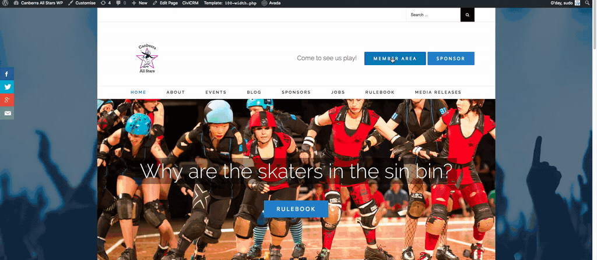
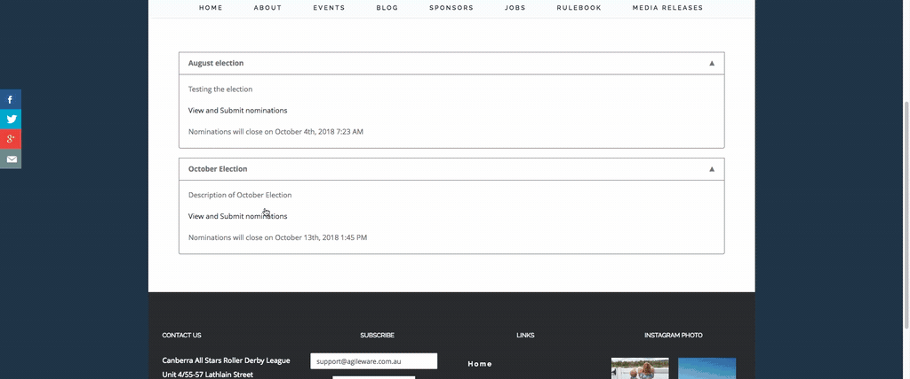
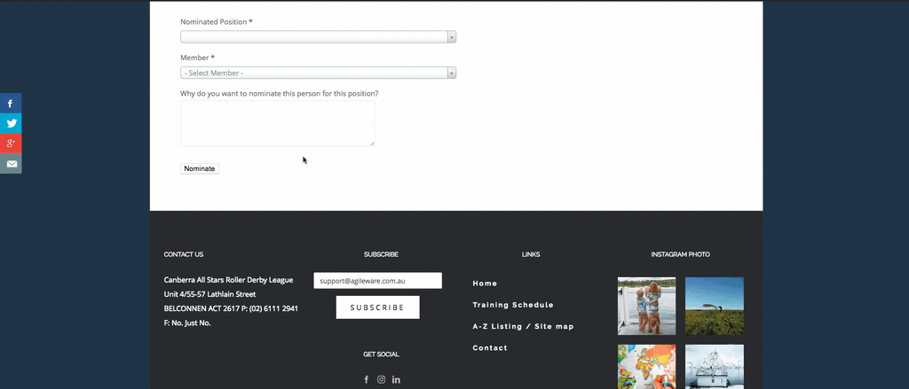
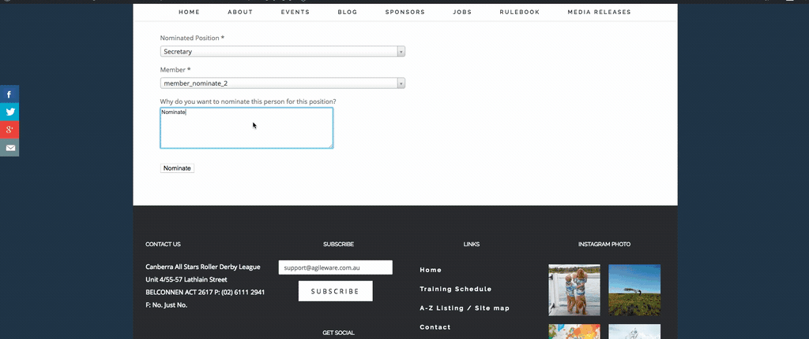

# How to nominate a user

You can nominate yourself, an existing nominees or a new person. Each nominee must be a permitted contact in CiviCRM (as defined in the Elections Settings).

1. Go to **Elections**  
  
2. Select **Nominate** on the election's card (the button says **Nominate** while nominations are open and you can nominate), then **Nominate** in the "what you can do now" panel of the election page  
     
3. Enter information on the **Nominate in** (election name) page:
- **Position**: Choose the position that you want to nominate the user in ("Select a position")  
- **Nominee**: Choose the name of the person that you want to nominate ("Select a person"). Type a name or email to search.  
- **Reason for the nomination**: Enter the reason why you want to nominate this person  

4. Select **Nominate** to nominate. The message "Nomination submitted." is shown. **Back to the election** above the heading leaves the form without nominating.

Depending on the election's settings, a nomination may need to be seconded by one or more other people before the nominee becomes an eligible candidate - see [How to second a nomination](user_second_nomination.md). The nominee can [decline or withdraw the nomination](user_withdraw_nomination.md) at any time before voting starts.
