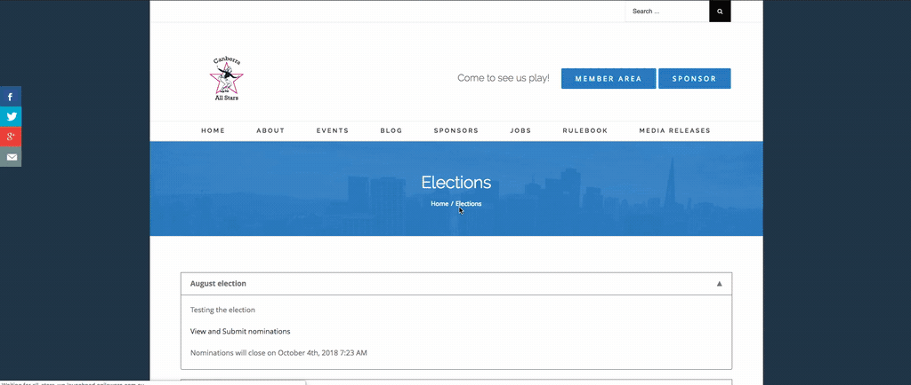
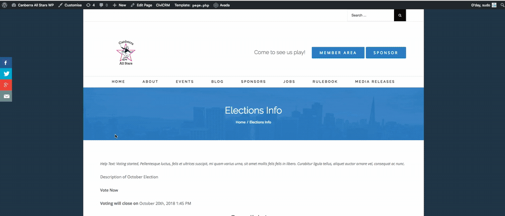
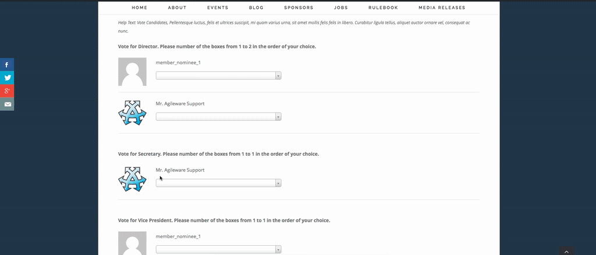
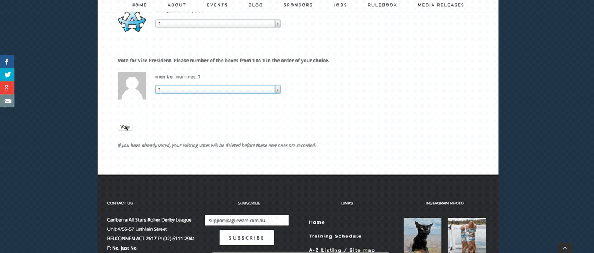

# How to vote

The election page shows the stages of the election (Nominations, Candidates, Voting, Results) with their dates, and one sentence about what you can do now, with a button. While voting is open it says **Voting is open until ...** and offers **Vote Now**.

To vote in an election, you must be a permitted contact in CiviCRM (as defined in the Election Settings) and the election must be in its voting stage, between the **Voting Start Date** and **Voting End Date**.

1. Go to the **Elections** page on the website
2. Go to required **Election**
3. Click the **Vote in the Election** link 
   
4. Click the **Vote Now** link
     
5. Read about the candidates. Depending on the election's [display options](admin_create_election.md), each candidate may have a **Read statement** link under their name, and candidate photos may be hidden. Select a name to see the candidate's full page.
6. Rank each Candidate in order of preference for each Position. You do not have to rank every candidate, or vote for every position, but if you rank any candidate for a position you must give one candidate the rank of 1, and each candidate for that position must be given a different rank.
     
As you choose ranks, a message under each position tells you how many candidates you have ranked and warns you at once if two candidates have the same rank or if no candidate is ranked 1.
7. Click **Vote**. A window shows your choices for each position in order. Nothing is saved yet: choose **Go back and change** to make changes, or **Confirm my vote** to record it.    

8. After voting, the election page shows **Your vote**: what was recorded, position by position. Only you see it, and only while voting is open.

If the election's settings allow it, you can vote again at any time before **Voting End Date** to change your vote - your latest vote replaces your previous one. If changing your vote is not allowed, you cannot vote again once you have voted.

## Elections counted by most votes

Some elections are counted by most votes instead of ranking. The ballot then has a tick box for each candidate and each position says how many you can choose (one for a single seat, up to the number of seats otherwise). A message under the position tells you how many you have chosen and warns you at once if you choose too many. You do not have to choose anyone in a position. The review step lists the candidates you ticked before anything is saved.
