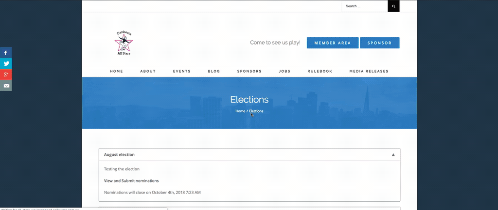
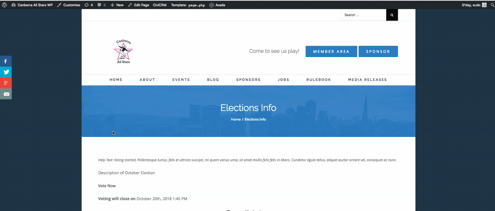
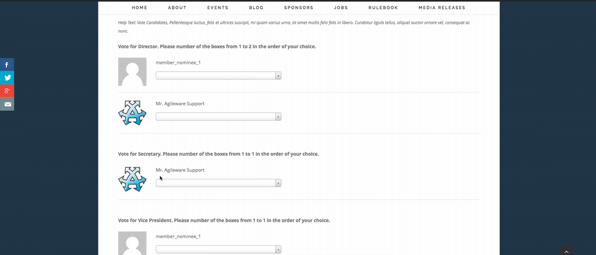
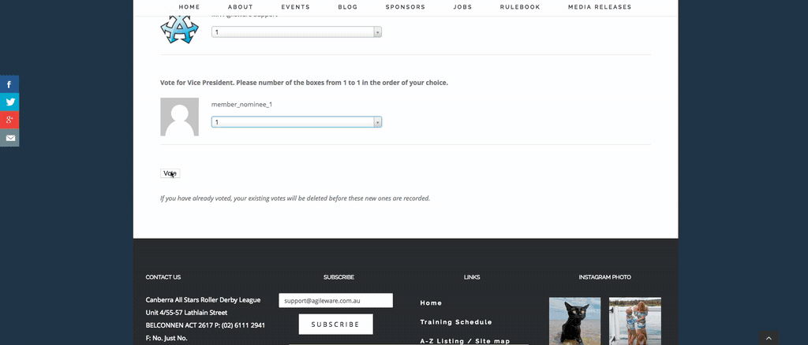

# How to vote

The election page shows the stages of the election (Nominations open, Candidates advertised, Voting open, Results published) with their dates, and one sentence about what you can do now, with a button. While voting is open it says "Voting closes on" followed by the date, and offers **Vote**. The page says "Times are shown in" followed by the site's time zone.

To vote in an election, you must be a permitted contact in CiviCRM (as defined in the Elections Settings) and the election must be in its voting stage, between **Voting opens** and **Voting closes**.

1. Go to the **Elections** page on the website
2. Find the required **Election**
3. Select the **Vote** button on its card (the button says **Vote** while voting is open and you have not voted; otherwise it says **View Election**) 
   
4. On the election page, select **Vote** in the panel that says what you can do now
     
5. Read about the candidates. Depending on the election's [display options](admin_create_election.md), each candidate may have a **Read statement** link under their name, and candidate photos may be hidden. Select a name to see the candidate's full page.
6. Rank each candidate in order of preference for each position. You do not have to rank every candidate, or vote for every position, but if you rank any candidate for a position you must give one candidate the rank of 1, and each candidate for that position must be given a different rank.
     
As you choose ranks, a message under each position tells you how many candidates you have ranked and warns you at once if two candidates have the same rank or if no candidate is ranked 1.
7. Select **Review Your Vote**. A window titled **Review Your Vote** shows your choices for each position in order. Nothing is saved yet: select **Go Back and Change** to make changes, or **Submit Vote** to record it. (If JavaScript is switched off in your browser, the button on the ballot is **Submit Vote** and records the vote straight away.)    

8. After voting, the message "Vote recorded." is shown and the election page shows **Your vote**: what was recorded, position by position. Only you see it, and only while voting is open.

If the election's settings allow it, you can vote again at any time before **Voting closes** to change your vote: select **Change Vote** on the election page. Your latest vote replaces your previous one. If changing your vote is not allowed, the page says "You voted on" followed by the date and "Your vote cannot be changed.", and you cannot vote again once you have voted.

## Elections counted by most votes

Some elections are counted by most votes instead of ranking. The ballot then has a tick box for each candidate and each position says how many you can choose (one for a single seat, up to the number of seats otherwise). A message under the position tells you how many you have chosen and warns you at once if you choose too many. You do not have to choose anyone in a position. The **Review Your Vote** window lists the candidates you ticked before anything is saved.

## Writing in a candidate

If a position allows write-ins, a **Write someone in** box appears under its candidates. Type at least three letters of a person's name and pick them from the list; in a ranked choice election give them a rank like any other candidate, and use **Add Another Write-in** if you have more places. The person is told straight away and must accept before voting closes. Your vote for them counts only if they accept; if they do not, it is dropped and your ballot moves on to your next choice. If you vote again later you will see them on the ballot once they have accepted.

## Questions

Some elections also ask yes or no questions. Each appears as a box with the question, the full resolution if there is one, and a button for each answer (for example For, Against and Abstain). Choose one, or leave it unanswered. Your answer is shown in the **Review Your Vote** window with the rest of your vote.
