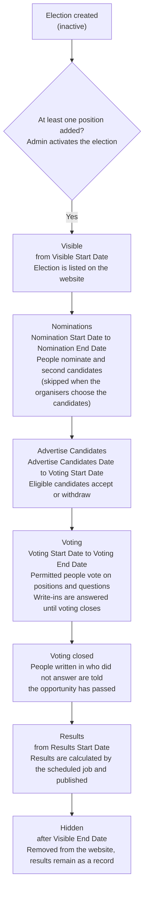
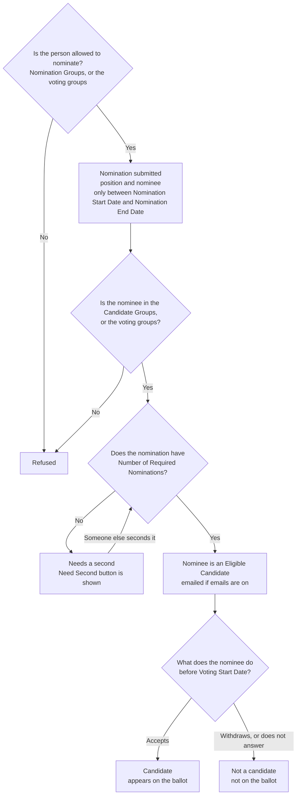
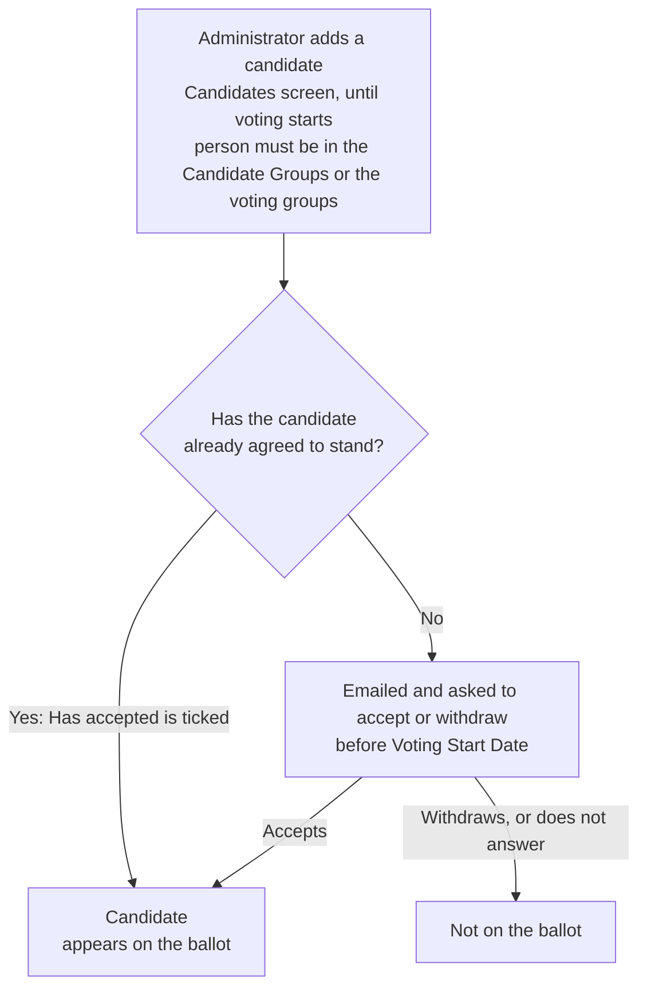
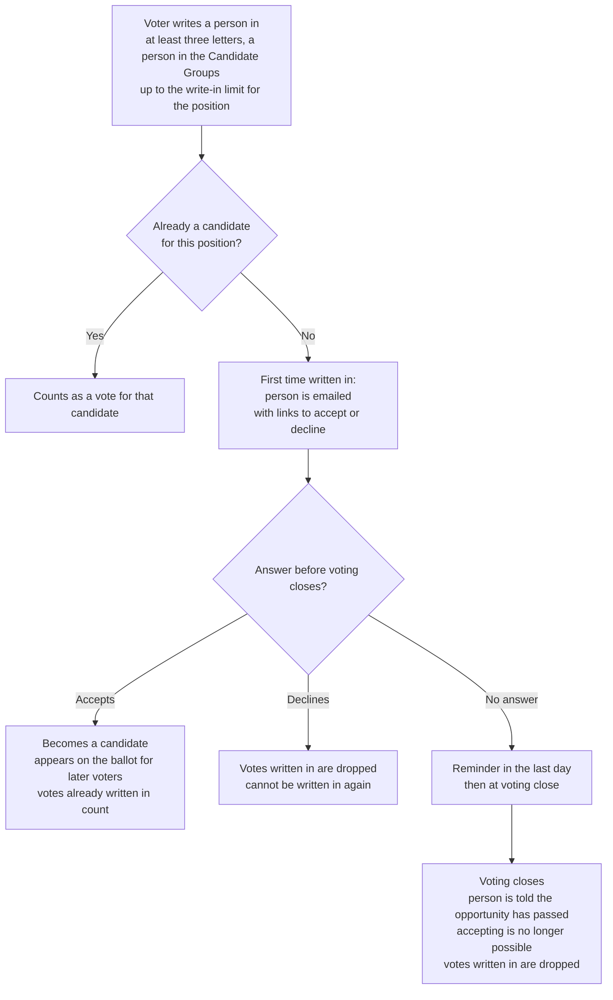
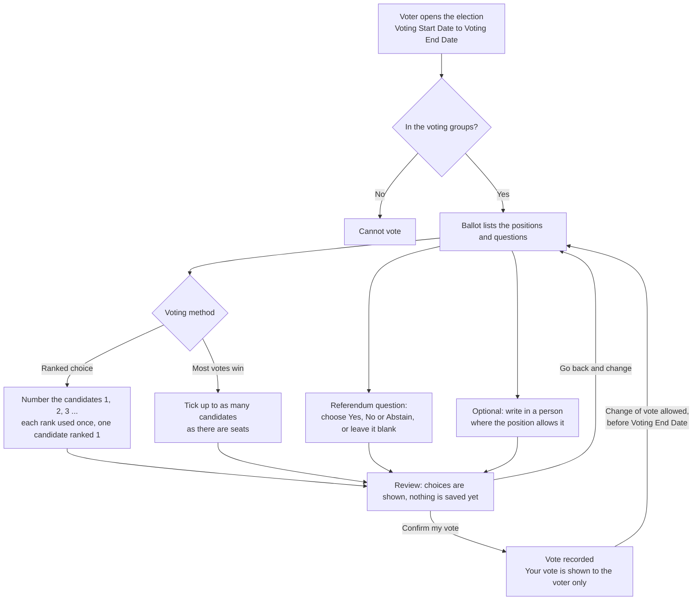
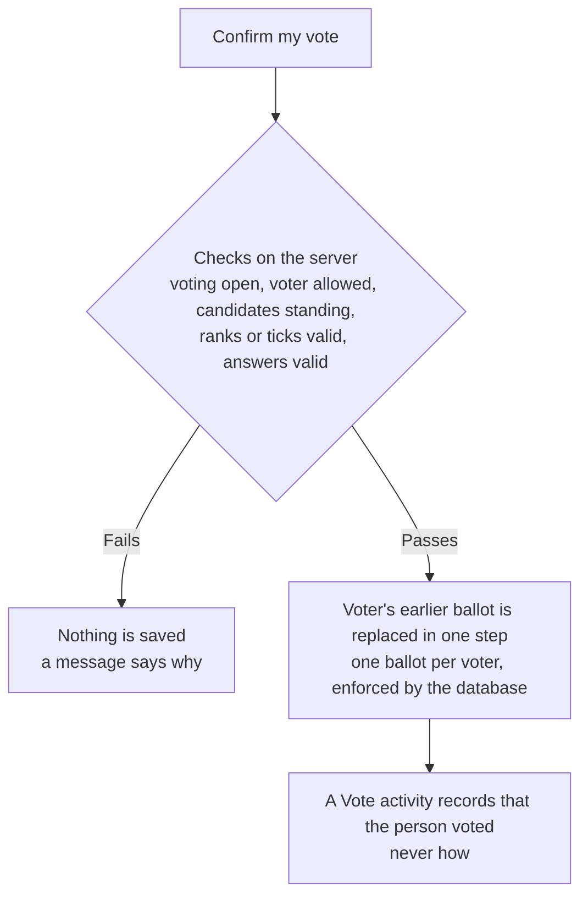
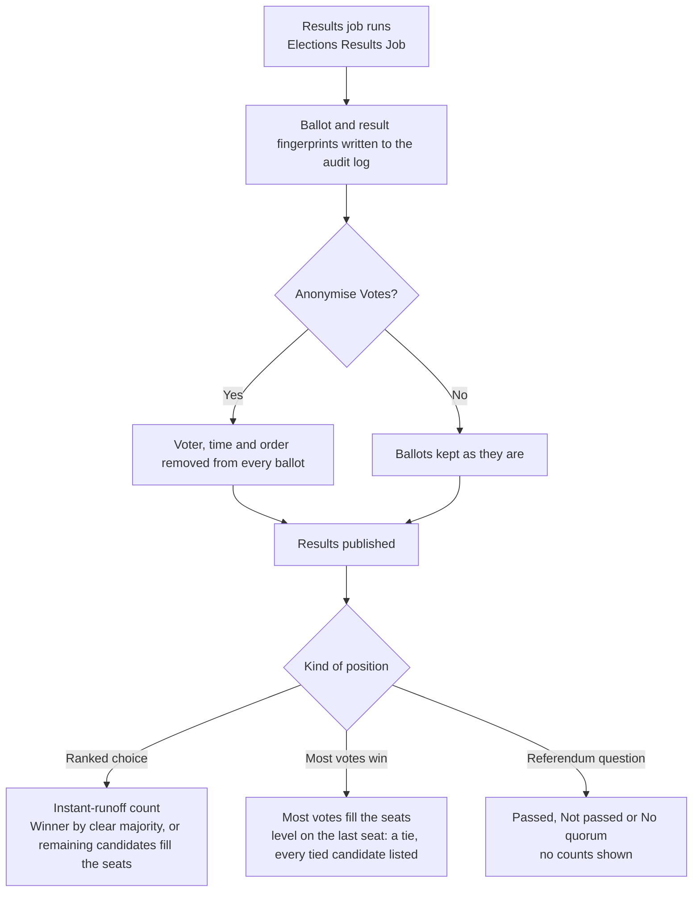
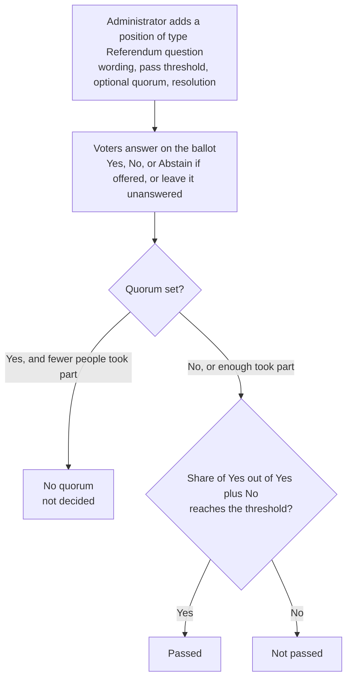

# Workflows

The diagrams in this chapter show how an election moves from start to finish, and how each kind of election differs. They follow each other: the election lifecycle (1), how people get on the ballot (2 to 4), how votes are cast (5 and 6) and how the results are decided (7).

## 1. Election lifecycle

An election moves through a fixed sequence of stages, each opened by a date set when the election was created - see [Creating an election](admin_create_election.md). The diagram shows the stages in order, the date that opens each one, and what happens in each.

An election which is not [activated](admin_activate_election.md), or which has no positions, is never shown to end users, regardless of the dates. The settings of an election can only be changed before its Nomination Start Date, and several of them are locked once the first vote has been cast.

## 2. Nominations by people

The default way to get on the ballot. Each nomination for a position follows this path.

A person nominating twice for the same position, or seconding twice, counts once. A withdrawn nomination cannot be nominated again for the same position. See [How to nominate](user_nominate.md), [How to second](user_second_nomination.md), [How to accept](user_accept_nomination.md) and [How to withdraw](user_withdraw_nomination.md).

## 3. Candidates chosen by the organisers

When **Allow people to nominate online** is off, there is no nomination form and no seconding.

See [Candidates](admin_candidates.md).

## 4. Write-ins

A position with **Write-ins per seat** above 0 lets voters add a person while voting is open. This is the only way anyone can join the ballot once voting has started.

If the person opens their accept or decline link after voting has closed, they see a message explaining that the opportunity has passed and that nothing more is needed. Nothing records who wrote anyone in. See [Write-ins](admin_write_ins.md).

## 5. A voter's path through the ballot

## 6. A ballot is saved

Whatever the kind of election, every vote is saved the same way, which is what keeps the ballot trustworthy.

## 7. From ballots to results

After the Voting End Date and on or after the Results Start Date the scheduled job counts the ballots once.

Results are generated once and cannot be regenerated or edited. The election overview checks the fingerprints and shows whether anything has changed. See [How to view election results](user_view_results.md) and [Security and audit](reference_security_and_audit.md).

## 8. A referendum question

Simple majority means more than half, so a tie is *Not passed*. Other thresholds (two thirds, three quarters) mean at least that share. Abstentions count towards the quorum and not towards the percentage. See [Referendum questions](admin_referendum.md).
